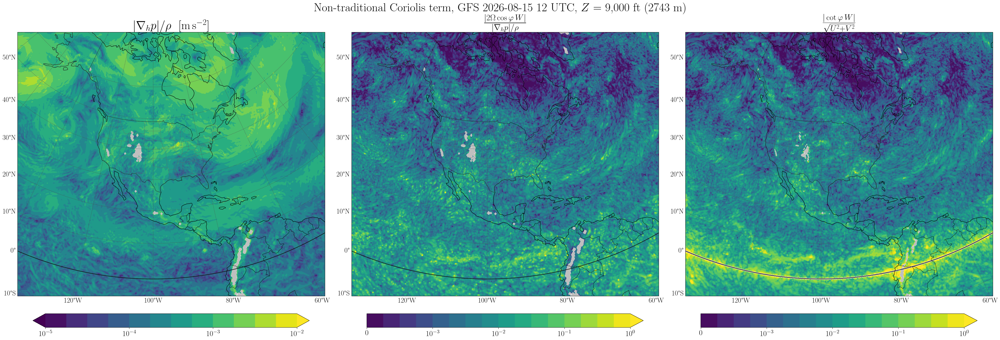

# A Five-Dimensional Geometric Formulation of Geophysical Fluid Dynamics

This repository accompanies the paper

> S. Gaudreault, S. Taylor, A. Nasiri, S. S. Seahra and R. J. Spiteri,
> *A Five-Dimensional Geometric Formulation of Geophysical Fluid Dynamics*

It contains a single Jupyter notebook, `differential_geometry_for_geophysics.ipynb`,
which reproduces the geometric results of the paper symbolically with SageManifolds,
and then uses real weather data to measure the size of one of the terms that the usual
shallow-atmosphere equations leave out.

## Motivation

Numerical weather prediction relies on solving the equations of fluid dynamics in
coordinate systems adapted to the Earth. In practice, this means longitude and latitude that
co-rotate with the Earth, together with a vertical coordinate that follows the terrain. Each of these choices introduces its own Coriolis, centrifugal and curvature terms
into the momentum equations. Deriving these terms by hand, and then deciding which of them
can be neglected, is prone to error. Moreover, neglecting terms inconsistently can break the
conservation of energy or angular momentum.

Tensor calculus provides a systematic way to handle these terms. When the equations are
written as tensor equations, all the coordinate-dependent terms follow from the metric
through its Christoffel symbols. Changing coordinates then amounts to transforming the
metric, rather than deriving each term anew. Charron, Zadra and Girard (2014) developed such
a formulation for the atmosphere in four dimensions, i.e. space plus time. In their
formulation, however, gravity remains outside the geometry, as an external force in the
momentum equation.

A natural question is whether gravity can be absorbed into the metric too, just as rotation
already is. For a single particle this was answered almost a century ago by Eisenhart (1928),
and later recast in modern language by Duval and collaborators: one adds a fifth coordinate,
and the path of a particle falling under gravity becomes a geodesic of the enlarged geometry.
The paper carries this idea over to a compressible, inviscid atmosphere. In other words,
gravity, the Earth's rotation and any time dependence of the coordinate levels now all live in
one five-dimensional metric, and every balance law of the fluid comes from a single tensor
equation.

## The formulation in brief

Let $t$ be absolute Newtonian time, $x^i$ (with $i = 1, 2, 3$) the spatial coordinates, and
$x^4$ the auxiliary coordinate. The five-dimensional line element is 

$$
d\ell^2 = g_{ij} dx^i dx^j + 2 g_{0i} dx^i dt - 2\Phi_e dt^2 + 2 dt dx^4 ,
$$

where $g_{ij}$ is the ordinary spatial metric, $g_{0i}$ describes the motion of the frame
(for example the rotation of the Earth), and $\Phi_e$ is the effective potential, which
combines the gravitational potential with a contribution from the frame motion (in a
rotating frame, the centrifugal potential). The fifth coordinate does not label anything
physical: no field depends on it, and moving along it alone covers zero squared length.

The fluid is described by a symmetric mass–momentum tensor $T^{AB}$, with indices $A, B$
running over all five coordinates. It packages the densities and fluxes of mass, momentum and
energy, including the internal energy of the gas and the work done by pressure. All the fluid
equations then follow from 

$$
\nabla_A T^{AB} = 0 .
$$

Its five components give, in turn, conservation of mass, the three components of the
momentum equation, and the evolution of internal energy; adding an equation of state closes
the system. Moreover, if the metric is independent of time, the same equation also implies
that total energy is conserved.

## What the notebook checks

The point of doing the geometry in SageManifolds is that the inverse metric, the
Christoffel symbols and the resulting accelerations are computed rather than derived by
hand, so each result in the paper can be checked independently. The notebook works through the paper in order:

| Notebook section | What is verified |
|---|---|
| Manifold and metric declaration | the general Eisenhart–Duval metric in arbitrary synchronous coordinates |
| Finding the inverse metric | inverting the full metric and keeping its spatial part gives back the inverse of $g_{ij}$; the time row, $g^{0A} = \delta^A_4$; the mixed components $g^{4i}$; and $g^{44} = g_{0i}g^{ij}g_{0j} + 2\Phi_e$ |
| Some Christoffel symbols | the symbols with an upper time index vanish in every synchronous coordinate system, and so do all symbols with a lower auxiliary index |
| Particle in a gravitational potential | Newton's second law as the geodesic equation of the five-dimensional metric |
| Spherical coordinates | the full connection of the rotating spherical metric, including gravity, the centrifugal term and the Coriolis terms |
| Thin-shell approximation | the connection of the approximate metric, which reproduces the usual shallow-atmosphere model, keeping only the Coriolis terms proportional to $\sin\varphi$ |

## Real data: how large is the non-traditional Coriolis term?

In rotating spherical coordinates, let $\lambda$ be the longitude, $\varphi$ the latitude,
$r$ the distance from the centre of the Earth, and $U$, $V$ and $W$ the wind components
towards the east, the north and upwards, measured relative to the rotating Earth. With $\Omega$ the rotation rate of the Earth,
$\rho$ the density and $p$ the pressure, the momentum equations derived in the paper read

$$
\frac{dU}{dt} - \frac{UV\tan\varphi}{r} + \frac{UW}{r} - 2\Omega\sin\varphi V + 2\Omega\cos\varphi W = -\frac{1}{\rho r\cos\varphi}\frac{\partial p}{\partial\lambda} ,
$$

$$
\frac{dV}{dt} + \frac{U^2\tan\varphi}{r} + \frac{VW}{r} + 2\Omega\sin\varphi U = -\frac{1}{\rho r}\frac{\partial p}{\partial\varphi} - \frac{1}{r}\frac{\partial\Phi_e}{\partial\varphi} ,
$$

$$
\frac{dW}{dt} - \frac{U^2+V^2}{r} - 2\Omega\cos\varphi U = -\frac{1}{\rho}\frac{\partial p}{\partial r} - \frac{\partial\Phi_e}{\partial r} .
$$

The thin-shell approximation replaces $r$ by a constant radius in the horizontal geometry and
in the rotation terms. The geometry is then simpler, but some terms disappear from these
equations. Among them are the two terms proportional to $2\Omega\cos\varphi$, which couple
the eastward and the vertical motion. These are the *non-traditional* Coriolis terms. One
might wonder how much is actually lost.

The last part of the notebook answers this for one real weather situation. It takes the
analysis of the Global Forecast System (GFS) of NOAA at 0.25° resolution for 2026-08-15,
12 UTC, over North America, interpolates pressure, temperature and the three wind components
to surfaces of constant geopotential height, and evaluates every term of the three momentum
equations above. The vertical wind $W$ is the geometric vertical
velocity that GFS itself publishes, not one inferred from the pressure velocity.



The three panels show, at a height of 9,000 ft (2,743 m):

1. the horizontal pressure-gradient acceleration, $|\nabla_h p|/\rho$, with $p$ the pressure
   and $\rho$ the density, which sets the scale of the horizontal dynamics;
2. the eastward non-traditional Coriolis term, $|2\Omega\cos\varphi W|$, divided by that
   pressure-gradient acceleration;
3. the ratio of the non-traditional to the traditional Coriolis acceleration,
   $|\cot\varphi W| / \sqrt{U^2 + V^2}$, where $U$ and $V$ are the eastward and northward
   wind.

Grey marks points with no data: ground above 9,000 ft (the Rockies and the Andes) and the
row on the equator itself.

The message to be taken from the figure is that the non-traditional term is small almost
everywhere, but not uniformly so. The median ratio to the traditional Coriolis term is about
$1.5\times10^{-3}$ between 30° N and 60° N and $4.8\times10^{-3}$ between 10° N and 30° N.
Towards the equator the term matters much more. Along the band of tropical convection just
north of the equator, where vertical motion is strong and the pressure gradient is weak, the
second panel shows the non-traditional term reaching ten percent of the pressure-gradient
acceleration and more. This is consistent with the scale estimate of White and Bromley
(1995), who found that the cosine Coriolis terms can reach about ten percent of the leading
terms in the tropics.

Some caveats are in order. This is a single snapshot at a single height, so it illustrates
the size of the term rather than establishing a climatology. A model at 0.25° resolution also
smooths out the strongest vertical velocities in convection, so the largest values are
probably underestimated. Finally, the third panel grows without bound towards the equator by
construction, because the traditional Coriolis term vanishes there. For the same reason, its
median between the equator and 10° N ($3\times10^{-2}$) overstates the physics, and near the
equator the second panel is the more meaningful measure.

## Running the notebook

The symbolic part needs only SageMath (SageManifolds is part of SageMath since version 7.5).
The data part additionally needs earth2studio, which downloads GFS from NOAA's public
archive on Amazon Web Services without any account, and cartopy for the maps. The figures
are typeset with LaTeX, so a LaTeX installation must be on the path.

The notebook was last run with SageMath 10.9, earth2studio 0.19, cartopy 0.26,
matplotlib 3.11 and NumPy 2.5. One way to build such an environment with conda is

```bash
conda create -n sage -c conda-forge sage pytorch cartopy jupyterlab
conda activate sage
pip install earth2studio
```

Note that PyTorch, which earth2studio depends on, should come from conda-forge, as above,
and not from pip. The pip wheel ships its own copy of the OpenMP runtime, and importing it
in the same process as Sage aborts the kernel.

Then start Jupyter from this environment, open `differential_geometry_for_geophysics.ipynb`
and run the cells in order. The data section needs an internet connection the first time it
runs, to download the GFS fields.

## Repository layout

- `differential_geometry_for_geophysics.ipynb`: the notebook described above.
- `figures/`: the figure shown in this README, exported from the last cell of the notebook.

## Citation

If you use this notebook, please cite the paper above. 
